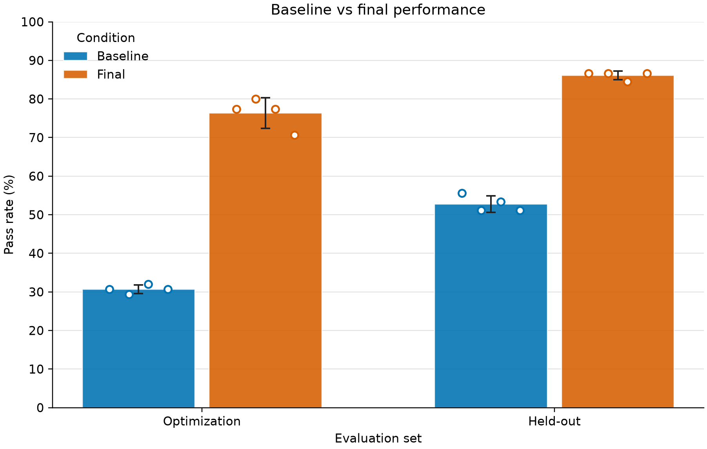
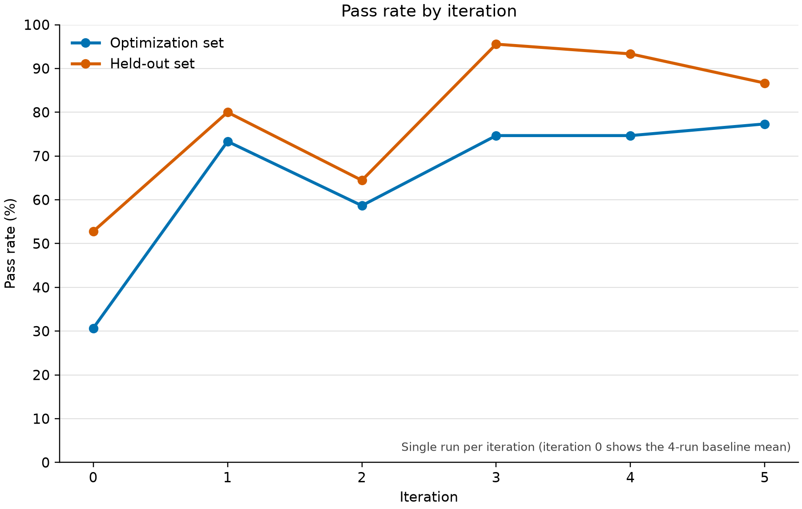

# A Minimal Recursive Self-Improvement Loop with Code Agents: A Small-Scale Empirical Study

**Author:** Ibrahima Lo
**Code and data:** this repository (`RSI_Experiment`)
**Companion literature review:** [RSI_Review](https://github.com/loibrahima577-creator/RSI_Review)

---

## Abstract

Recent work on recursive self-improvement (RSI) — STOP, the Gödel Agent, the Darwin Gödel Machine — shows that language-model systems can rewrite parts of their own scaffolding. Most of these studies are expensive and hard to reproduce. We build the smallest loop we could think of that still deserves the name: a *solver* scaffold turns a task description into Python code with one LLM call, and an *improver* model rewrites the scaffold's source from the failures it produces on an *optimization* set only. Each iteration is also evaluated on a *held-out* set that the improver never sees. Over five iterations, the pass rate (fraction of unit-test assertions passed) rose from 30.7 % ± 1.1 to 76.3 % ± 4.0 on the optimization set and from 52.8 % ± 2.1 to 86.1 % ± 1.1 on the held-out set (mean ± standard deviation over four repeated evaluations of the same scaffold). The gain is far larger than the evaluation noise. But the evidence is limited: one improvement trajectory, 20 small tasks, one solver model, and held-out tasks that share the optimization tasks' hidden conventions. We report these limits in detail, along with a negative result: our first benchmark was saturated and could not show any improvement.

## 1. Introduction

Our [literature review](https://github.com/loibrahima577-creator/RSI_Review) mapped the field of recursive self-improvement. One gap stood out: many papers describe self-improving systems, but few offer a loop that a single person can run, inspect and repeat on a small budget. This study asks a deliberately narrow question:

> **Can a code-generating agent improve its own scaffold, using only feedback from a set of tasks, in a way that also helps on tasks it has never seen?**

*Hypothesis.* A scaffold rewritten from failure feedback will pass more tests than the baseline on the optimization set, and the improvement will carry over to held-out tasks.

We do not claim anything about open-ended or unbounded self-improvement. This is a controlled mini-experiment in the spirit of STOP (a scaffold improving the program that improves programs) but with a much smaller and fully inspectable setup.

## 2. Method

### 2.1 Solver scaffold

The scaffold is one Python file exposing `solve(task_prompt, model=None) -> str`. The baseline (`versions/scaffold_iter_0.py`) makes a single LLM call and returns Python code (markdown fences stripped). The solver model is `gpt-5.6-luna` at low reasoning effort, accessed through an API provided by our institution.

### 2.2 Tasks and tests

Each task is a short natural-language description of a Python function plus a hidden test file written as plain `assert` statements against a module called `solution`. A task is scored by the fraction of its test assertions that pass; the benchmark score is total assertions passed over total assertions.

**Benchmark v1 (`tasks/`) — a negative result.** Our first 20 tasks were standard small programming exercises. The solver already reached about 100 % (71/71 on optimization, 48/49 on held-out). With no headroom, no self-improvement could be measured. We kept these results as evidence of a ceiling effect.

**Benchmark v2 (`tasks_v2/`).** We rewrote the tasks so that the tests check *house conventions* that are not stated in the prompts, for example: do not mutate the inputs; raise `ValueError` on invalid input; return tuples rather than lists; compare strings case-insensitively; return `None` for empty input; keep stable order for ties. A baseline that only reads the prompt fails on these details, which leaves room for improvement. The list of conventions is in `private/conventions.md`.

The 20 tasks are split once, in `tasks_v2/split.json`, into an **optimization set** (12 tasks, 75 assertions) and a **held-out set** (8 tasks, 45 assertions).

### 2.3 The improver

The improver is `gpt-6.1-sol` at high reasoning effort. At iteration *i* it receives (a) the current scaffold source and (b) the list of failures from the optimization set only (task description, error, test feedback). It returns a complete new `scaffold.py`.

**Safety check.** Before a candidate scaffold is used, an AST check enforces a whitelist: imports limited to `re`, `json`, `textwrap`, `typing` and `from llm import call_llm`; no `open`, `exec`, `eval`, `compile`, `__import__`, `os`, `sys`, `subprocess`, `socket`, `pathlib`, `shutil`, and no string containing `auth.json`. Rejected candidates are saved as `versions/rejected_iter_i.py`.

### 2.4 Protocol

1. Evaluate the baseline scaffold (iteration 0) on both sets.
2. For *i* = 1…5: ask the improver for a new scaffold from the optimization failures of the previous scaffold; run the safety check; evaluate the new scaffold on both sets; log the result.
3. **Noise measurement.** Evaluate the baseline and the final scaffold four times each on both sets (runs 0, 101, 102, 103 for the baseline; 5, 201, 202, 203 for the final scaffold).
4. **Leakage audit** (`audit_leakage.py`): confirm that held-out function names and long held-out lines appear in none of the improver logs or scaffold versions, and that the improver's input is built only from optimization results.

**Choice of the final scaffold.** We use iteration 5 as the "final" scaffold. It is simply the last iteration, and it is also the best on the optimization set (77.3 %). It was *not* chosen by looking at the held-out set.

## 3. Results

### 3.1 Baseline versus final scaffold

| Condition | Optimization (12 tasks) | Held-out (8 tasks) |
|---|---|---|
| Baseline (iteration 0) | 30.7 % ± 1.1 (min 29.3, max 32.0) | 52.8 % ± 2.1 (min 51.1, max 55.6) |
| Final (iteration 5) | 76.3 % ± 4.0 (min 70.7, max 80.0) | 86.1 % ± 1.1 (min 84.4, max 86.7) |
| Gain | **+45.6 points** | **+33.3 points** |

Mean ± standard deviation over 4 evaluations of the same scaffold. The ranges do not overlap: the best baseline run is below the worst final run on both sets.

### 3.2 Trajectory over iterations

| Iteration | Optimization | Held-out |
|---|---|---|
| 0 (baseline, 4-run mean) | 0.307 | 0.528 |
| 1 | 0.733 | 0.800 |
| 2 | 0.587 | 0.644 |
| 3 | 0.747 | 0.956 |
| 4 | 0.747 | 0.933 |
| 5 | 0.773 | 0.867 |

Observations:

- Most of the gain appears at **iteration 1**.
- The trajectory is **not monotonic**: iteration 2 is clearly worse than iteration 1 on both sets. All five candidates were accepted by the loop (`accepted = true` in `results/summary_v2.csv`). The loop sets `accepted` to the result of `check_scaffold(candidate)`. That check returns true only if the candidate parses as Python; imports are limited to `re`, `json`, `textwrap`, `typing`, and unaliased `from llm import call_llm`; it contains no forbidden name or attribute (`open`, `exec`, `eval`, `compile`, `__import__`, `os`, `sys`, `subprocess`, `socket`, `pathlib`, or `shutil`) or string containing `auth.json`; it defines exactly one synchronous top-level `solve` with positional arguments `task_prompt` and `model`, `model=None`, no positional-only, variadic, or keyword-only arguments, and `task_prompt: str` and `-> str` annotations; and `solve` calls `call_llm`. Any exception in the improver/check block sets `accepted` to false.
- Each point after iteration 0 is a **single run**. Error bars on the final scaffold (Section 3.1) reflect solver noise only.
- Held-out scores are sometimes higher than optimization scores. The held-out set is small (45 assertions) and its tasks may simply be easier; we do not read this as "better generalization than optimization".

### 3.3 What the improver changed

The final scaffold (`versions/scaffold_iter_5.py`) adds general guidance to the solver prompt: match the expected return shape (tuples vs lists), return `None` for empty input, check preconditions and raise `ValueError`, and keep stable ordering for ties and first-seen group order. For example, it says: “Use tuples for sequence results unless the task explicitly requires another type.” It also says: “Unless the task specifies otherwise, return None for empty top-level input.” In other words, the improver inferred, from failures, the kinds of conventions the tests enforce, and wrote them into the scaffold.

## 4. Limitations

We want the reader to weigh the results with these in mind.

1. **One improvement trajectory.** The standard deviations measure how noisy *evaluating one scaffold* is. They do not measure how variable *the improvement loop itself* is. In a preliminary test, the same iteration 1 produced about 35 % on the optimization set in one run and 73 % in the main run, depending on what the improver generated. A fair estimate of the loop's variability requires several independent trajectories.
2. **Shared conventions.** Held-out tasks use the same hidden conventions as the optimization tasks. Our result is generalization *across tasks that share conventions*. It is not evidence that the scaffold would handle unseen rules.
3. **A benchmark built to leave headroom.** We rewrote v1 to v2 precisely because v1 was saturated. The effect size depends on that design choice, and results on a naturally occurring benchmark could be smaller.
4. **Small scale.** 20 tasks and 120 assertions in total. Assertions within a task are not independent.
5. **One solver model and one improver model.** Results may not transfer to other models.
6. **Assertions as the metric.** The pass rate counts assertions, so tasks with more tests weigh more.
7. **Not open-ended self-improvement.** The improver is a fixed, separate model that rewrites a scaffold; the system does not modify its own improver. This is a scaffold-level loop, closer to a controlled illustration of the idea than to the strongest forms of RSI discussed in the literature.
8. **Leakage audit is heuristic.** It checks function names, long lines and the data flow in the code. It cannot rule out every form of indirect leakage.

## 5. Reproducibility and safety

- Run order: `python list_models.py`, then `python evaluate.py --set optimization --iter 0 --tasks tasks_v2 --model gpt-5.6-luna`, then `python run_loop.py --tasks tasks_v2 --model gpt-5.6-luna --iterations 5`, then `python audit_leakage.py`, then `python analyze_results.py`.
- Every result is saved as JSON/CSV in `results/`, every scaffold version in `versions/`, every improver prompt/response in `logs/`.
- The API key is read at run time from the local Codex configuration and is never written to the repository (`.gitignore`, and a scan of tracked files for key patterns found nothing).
- Generated code is executed locally on small tasks; the scaffold safety check limits what a rewritten scaffold may import or call.
- LLM outputs are non-deterministic, so exact numbers will differ on a new run. The *direction and size* of the baseline-to-final gap is the claim, not the third decimal.

## 6. Conclusion and future work

In a minimal setting, a code-generating scaffold improved substantially (+45.6 points on the optimization set, +33.3 on held-out) after five rewrites driven only by optimization-set failures, and the gain is far larger than evaluation noise. The honest reading is a *proof of feasibility on a small, designed benchmark*, not a general result. The most valuable next steps are:

1. Repeat the whole loop several times to estimate trajectory variance.
2. Add held-out tasks with *new* conventions to test generalization to unseen rules.
3. Add a rollback rule (reject candidates that do not improve optimization score) and compare it with accept-all.
4. Vary the solver and improver models.
5. Let the improver also modify its own prompt, moving toward the recursive setting studied in STOP and the Darwin Gödel Machine.

## References

Use the bibliography of the companion review ([RSI_Review](https://github.com/loibrahima577-creator/RSI_Review)) for STOP (Zelikman et al.), Gödel Agent (Yin et al.) and the Darwin Gödel Machine (Zhang et al.), and copy the exact entries from there.
